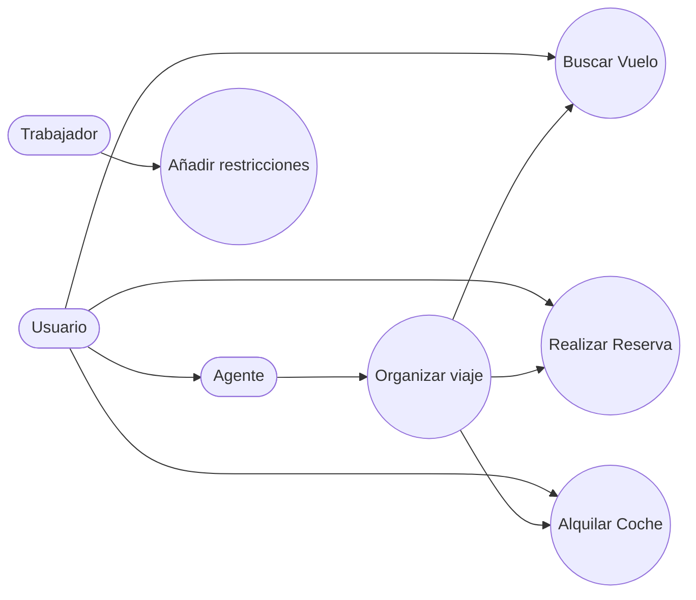

   ## Información
    los actores de este diagrama son: usuarios,agentes,trabajadores

    los casos de uso de este diagrama son:
    1-Buscar Vuelo: Los usuarios podran buscar la ciudad de salida y la ciudad de destino y podran seleccionar la fecha de viaje 
    
    2-Realizar Reserva de Hotel : El usuario podra escoger la ciudad de donde quiere el hotel escoger las estrellas que quiere que tenga y realizar la reserva 

    3-ALquilar Auto: El usuario podra escoger el modelo de coche y los dias que quiere alquilar el auto 
   
    4-Organizar Viaje: El usuario podra contratar a un agente para que le haga todas las gestiones anteriores
    
    5-Añadir Restricciones: Los trabajadores de la empresa podran añadir algunas restricciones como decir si los coches ya estan alquilados , si el hotel ya esta lleno o si no estan disponibles o no los vuelos 

## Casos de uso

    

    
    
    
    
    
    
    
    
    
    
    
    
    
    
    
    
    
    
    
    
    
    
    
    
    
    
    
    
    
    
    
